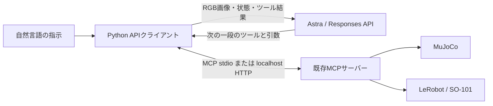

# APIから動かす提出版

構成上は、画像を見て判断する役を「会話中のCodex」から「外部APIのモデル」へ置き換える。MCPツール、MuJoCoの接触物理、ローカルのIK・補間・範囲・速度・停止は共通。モデルやプロンプト、応答時間が変わるため、成功率や判断が同一とは限らない。



API呼出しは`so101_mcp/api_agent.py`だけが行う。`server.py`はLLMを呼ばない。MCPサーバーをインターネット公開する必要はない。カメラ画像と指示・状態・ツール結果は、判断のためOpenAI APIへ送られる。

## 初回起動

1. `uv sync --locked`で依存を入れる。
2. ローカルの`.env`へ`OPENAI_API_KEY=...`を設定する。シェル環境変数でもよい。キーは提出物に含めず、チャットにも貼らない。ChatGPTアプリのログインをAPIキーとして使う構成ではない。
3. 下記コマンドを実行する。既存の実機サーバーは使わず、新規MuJoCoプロセスを起動する。

```sh
uv run --locked python -m so101_mcp.api_agent \
  --model gpt-6-astra \
  --instruction "赤いブロックを箱に入れて" \
  --output artifacts/api_runs/red_block.local
```

`--output`は新規または空のディレクトリが必要。省略すると日時付きで作る。既定のsim設定は`config/physical_ai/sim_staged.json`。環境・初期化・物理は従来どおりで、物体の正解位置・ID・寸法・仮想深度をモデルへ渡さない。高さは可視の垂直辺と既知支持面から推定する従来の条件付き方式。

モデルは`--model`、環境変数`OPENAI_MODEL`、設定JSONの順に優先する。既定は`gpt-6-astra`、利用権限がない場合も自動的に別モデルへ切り替えない。この識別子、画像入力・function callingの対応は2026-11-01に[公式モデル資料](https://developers.openai.com/api/docs/models/gpt-6-astra)で確認した。

## 既存MCPへの接続

```sh
# 端末1：シミュレーションをHTTPで起動
uv run --locked python -m so101_mcp serve --backend sim \
  --config config/physical_ai/sim_staged.json --transport streamable-http \
  --run-dir artifacts/api_http_sim.local
# 端末2：上記サーバーをAPI判断役へ接続
uv run --locked python -m so101_mcp.api_agent --backend sim \
  --url http://127.0.0.1:8765/mcp --instruction "赤いブロックを箱に入れて"
```

同じサーバーを他の操作者やAIから同時操作しない。接続時にbackend・接続・停止・実行中状態を照合し、不一致なら操作しない。

実機は操作者が起動した既存サーバーだけに接続できる。接続指定は`--backend real --allow-real --url http://127.0.0.1:8765/mcp`。このクライアントは実機を起動せず、ARMや停止解除を代行しない。実機サーバーの既定は従来どおりドライランで、ドライラン完了を物理成功に変えない。**今回の実機は電圧異常で中断しており、APIクライアントによる実機動作試験も未実施。**

## 一段ごとの処理

1. `observe`のPNGをそのままbase64の`input_image`として送信する。ファイルパスだけの入力にはしない。
2. モデルが`measure_height`等で対象・辺を選び、`prepare_cartesian_step`または`prepare_step`で次の一段を指定する。ローカル側で検査済みのPython・JSON・プレビューを保存する。
3. プレビュー画像を次のAPI呼出しへ渡す。モデルがそのprogram IDの`execute_skill`を選んだ時だけ実行する。生成Pythonのファイル起動と同じMCP実行入口を使うため、APIクライアント自身はファイルをexecしない。
4. 完了待ちはクライアントが100ms間隔で行う。モデルへのポーリング依頼は不要。完了後に必ず新しいRGBをAPIへ送り、次段を決めさせる。
5. `finish_task`で視覚的な最終判断と根拠を記録する。動作後なら共通`report_result`にも保存する。**指令完了、AIの視覚判断、独立した物理評価は別項目**。このクライアントは独立評価ファイルを読まない。

Responses APIの[function calling](https://developers.openai.com/api/docs/guides/function-calling)と[画像入力](https://developers.openai.com/api/docs/guides/images-vision)に従う。`parallel_tool_calls=false`、ローカルJSON Schema照合、準備済みprogram IDの照合を併用する。MCPの任意キー辞書を含むschemaは`strict=false`と明示し、クライアントとサーバーで検査する。単純な終了schemaだけstrictにする。状態はメモリ内の履歴で引き継ぎ、`store=false`とし、返された暗号化reasoning項目も継続入力へ渡す。APIキーとreasoning本文はログに書かない。

## 上限・停止・失敗

`config/physical_ai/api_agent.json`でモデル、reasoning effort、API応答80回、動作30段、全体900秒、1 API応答90秒、1動作70秒、出力4096 token/応答、累積1500000 tokenの上限を指定する。累積tokenはキャッシュ済みの入力履歴も含む返却usageで検査するので1応答分の超過はあり得る。料金上限そのものではない。初回の実API試験は旧上限250000 tokenで途中停止したため、履歴を含む搬送試行に合わせて上限を修正した。課金・利用権限・レート制限は利用アカウント側でも設定する。

Ctrl-C、API障害、応答/動作の期限切れ、上限到達、異常な引数、複数同時指令、重複call ID、動作失敗では停止を要求する。API・動作の自動リトライはしない。API障害が解消しても続行せず新規試行にする。正常終了時もstopをラッチし、接続済みHTTPサーバーの再利用にはローカル再起動が必要。

サーバーのSTOPファイルはAPI応答待ちに依存しない。自動起動版は出力ディレクトリ内の`sim/STOP`、外部HTTP版はサーバー側run-dirの`STOP`。別端末から例:

```sh
uv run --locked python -m so101_mcp stop --run-dir artifacts/api_runs/red_block.local/sim
```

ネットワーク断や強制終了でstopの応答が得られない場合、ログは未確認とする。実機の非常停止は既存のローカル手順に従う。ソフトウェア停止で物理停止を保証する構成ではない。

## 証拠と今回の検証範囲

- `result.json`：要求/返却モデルID、API応答数、動作要求数、usage、時間、終了理由、AI視覚判断、停止要求確認。
- `events.jsonl`：モデルのtool callとMCP結果、画像の相対パスとSHA-256。生のHTTP認証情報や推論本文は保存しない。
- `*.png`：モデルへ送った観測とプレビュー。`sim/programs/`：生成Python/JSON。`sim/simulation.mp4`：自動起動時の実sim映像。
- `sim/events.jsonl`と`sim/evaluation_private.json`：サーバーの動作ログと独立評価用状態。後者をモデル入力へ混ぜない。

初期の`verify_api_client.py`では、モデルのHTTP応答だけを模擬し、実MuJoCoと実MCPで観測・一段生成・1度のpan動作・再観測・停止まで確認した。これは接続・制御のソフトウェア試験で、AIの認識成功でも把持成功でもない。証拠は`artifacts/api_client_verification.json`。

その後、**実Astra APIで赤いブロックを箱へ移載する2試行を実施し、1件の完了を確認した。** 初回は累積token上限で途中停止し、動作5回・API応答15回・75.67秒。上限修正後は動作11回・API応答28回・132.75秒で完了した。画像の視覚判断と、全モデル判断終了後の独立物理状態（赤の全水平外形が箱内、静止、指と非接触、青は箱外）が一致した。生成前の到達不能・移動量超過による却下3件をモデルが修正した。応答のモデル識別子は`gpt-6-astra`。同一初期配置の開発確認で、無作為条件での成功率とは扱わない。

集計は`artifacts/api_live_verification.json`、選別した両試行の証拠は`artifacts/api_evidence/`。生のAPI認証情報・推論本文・実機画像は含めない。日時や場所はPDFへ転記せず、試行数・所要時間・失敗理由を記載した。独立評価は最終動作完了時点の物理状態であり、終了画像も別に照合した。

```sh
# APIキー不要。実機は使わない。再実行時は新規outputを選ぶ。
uv run --locked python -m scripts.verify_api_client \
  --output artifacts/api_transport_check.local
uv run --locked python -m pytest -q tests/test_api_agent.py
```

従来の補足動画と7 runの既存ログは会話中のCodexを判断役として得たもの。正確なホストモデルIDは未記録であり、Astra APIの実験として説明しない。今回の提出推奨動画は`submission/astra_api_demo.mp4`で、実APIによる完了試行を収録した2分36.8秒の映像。シミュレーション時間1倍速、API待機を含む全原フレームと後編集の説明字幕を使用する。

API runは`.local`に保存し、公開用exportへ自動収録しない。今回の完了した2試行だけを`python -m scripts.summarize_api_runs`で選別し、上限中断を含めた画像・ログ・生成Python・原映像を公開用ZIPへ追加した。実機でのAPI搬送は未検証。
