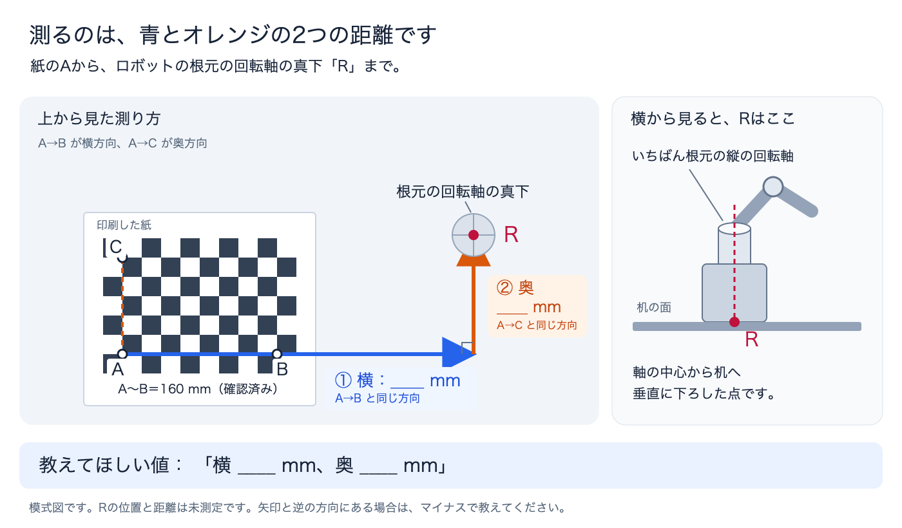

# 実RGBで共通化する範囲と校正

通常構成はRGB・関節・グリッパー開度を使う。本ページは固定RGBの内部・外部校正手順。最新の未知高さ版は[STAGED.md](STAGED.md)、実機写真だけを使う高さ確認と視点変更の結果は[CAMERA_POSITION.md](CAMERA_POSITION.md)を参照。未知高さは校正済みカメラ・既知支持面・同じ可視の垂直辺がある場合に限る。以下の`locate_on_plane`例と最後の旧試行は既知30mmを使った別条件。

2026-11-01のローカル設定は640×360 / 30fps。C920作業台カメラの実画像と6モーターの読み取り、実機MCP観測を確認済み（[接続記録](REAL_CONNECTION.md)）。実画像31枚から内部校正の下書きを保存した。紙がたわんだ5枚は目視確認と画像ハッシュ付きの理由を残して除外し、元画像を保持。26枚のうち21枚を推定、5枚を検査に使用した。再投影RMSは0.1625px、検査側の最大値は0.1637px、推定した板法線の変化は両軸29.55度・17.41度だった（[数値記録](../../artifacts/real_camera_calibration_verification.json)）。これらはミリメートル精度の実測ではない。印刷寸法は操作者がA〜Bの8マス分を160mmと測定し、設定の20mm/マスと一致した。測定誤差の幅は未報告。フォーカス固定・外部校正・独立した実寸精度・実機搬送は未検証で、実機用校正として有効化していない。手首カメラは腕が動くと外部パラメータが変わり、現在の固定校正を使えない。

| 処理 | sim | real |
|---|---|---|
| RGB・関節・開度 | 動作確認済み | 現物の読み取りとMCP画像返却を確認済み |
| カメラ校正 | 模型のカメラ設定 | 内部校正と、実測XYに基づく外部校正の下書きを保存。実寸精度は未検証 |
| locate_on_plane | 確認済み | 同じ計算関数。模擬実機画像でテスト済み |
| 固定置き場搬送 | 確認済み | 教示した経由点を使用。教示と現物試験が必要 |
| 段階XYZのIK・生成Python | simで確認済み | 共通コード実装、実機の関節・手先・作業座標校正が未検証 |
| 未知高さの測定・搬送 | 可視垂直辺で測定。搬送の失敗も記録 | 実画像2物体を確認。高さを聞く前の初回は棄却、実測値を知った後の比較を別記録。実寸精度・搬送は未検証 |

OpenCVの[カメラ校正](https://docs.opencv.org/4.13.0/dc/dbb/tutorial_py_calibration.html)と[solvePnP・座標変換](https://docs.opencv.org/4.13.0/d9/d0c/group__calib3d.html)を使用。校正板検出はカメラ幾何を求める処理で、作業対象は実行時にAIがRGBを見て選ぶ。

## 解像度と校正板

固定カメラのフォーカス・ズーム・解像度を維持する。校正と運用の両方で、real設定の`camera_index_env`が指すローカル環境変数と、`SO101_CAMERA_WIDTH`、`SO101_CAMERA_HEIGHT`、`SO101_CAMERA_FPS`を参照する。未設定の寸法はreal設定を使う。OSのカメラ番号は接続順で変わりうるため、実画像を確認してローカル設定を選ぶ。フォーカス固定の成否は未検証で、ソフトウェアから固定できたとみなさない。

`output/pdf/rgb_checkerboard.pdf`を100% / 実寸で印刷する。9×6の内側交点、20mmのマス。実際に印刷された辺の長さを測り、以降の`--square-mm`をその値に合わせる。板を平らに保持する。再生成は`python scripts/calibrate_rgb.py board --output NEW_FILE.pdf`。

## 内部校正

ブラウザーの撮影画面を使う場合:

```sh
uv run --locked python scripts/calibrate_rgb_live.py --config config/physical_ai/real_staged.local.json --output artifacts/checkerboard_capture.local
```

ローカル設定の作成は[接続手順](REAL_CONNECTION.md)を参照。`http://127.0.0.1:8770/`でカメラだけを開く。PDFへのリンク、交点検出の重ね表示、1枚撮影、20枚の自動撮影、一時停止、計算、カメラ終了を用意した。5マス分を実測して5で割り、1マスの実測値を入力する。確認欄は最初は未選択。カメラを固定したまま紙を動かし、中央・上下左右・異なる距離・上下左右への傾きを含める。紙は平らな板に貼り、各姿勢で約2秒静止する。同じ姿勢や見切れ、検出中の移動を拒否する。保存は交点を検出した元のPNGと対応点JSONの組で、実画像は`.local`内に保持する。

最低15枚を要求し、5枚に1枚を内部パラメータの推定から除外して検査に使う。学習側のRMS・画像中心の広がりに加え、板法線の両方向15度以上の変化と検査画像1.5px以下を確認する。これは撮影品質の検査であり、ミリメートル精度の保証ではない。結果は`intrinsics_draft_*.json`、`verified=false`で保存し、実機設定へ自動適用しない。以降の外部校正ではこのJSONを`--intrinsics`へ渡す。`カメラを終了`またはCtrl-Cで終了する。

20枚に達しても傾きが不足した場合は「5枚を追加撮影」を使う。傾けるとは、紙を本や板で平らに支え、その手前側・奥側・右側・左側を机から5〜10cm程度持ち上げること。机上で滑らせるだけでは不足する。紙単体のたわみは平面という前提を満たさない。保存の事前チェックは全54交点・画面内の余白・格子領域が画面の2.5%以上であることも見る。この面積閾値は本実装の撮影用ヒューリスティックで、印刷寸法の検査や精度保証ではない。

同じ固定カメラの撮影を再開する場合は上のコマンドへ`--resume`を付ける。カメラ番号・解像度・既存画像のハッシュと枚数を照合し、過去画像を上書きしない。`capture_review.json`に、目視で確認した幾何条件違反の画像名・元画像SHA-256・具体的な除外理由を記録すれば、推定から除外できる。元画像と失敗した計算の記録は残す。最終の下書きにも採用画像・除外画像・推定用と検査用の対応を保存する。

以下は1枚ずつCLIで撮る手順。両方式で同じカメラを同時に開かない。

```sh
uv run --locked python scripts/calibrate_rgb.py capture --output artifacts/rgb_calibration.local/intrinsics/view01.png
```

カメラだけを開き、ロボットバスには接続しない。校正板の位置・距離・傾きを変え、ファイル名を変えて最低10枚（目安15〜20枚）撮る。上下左右に広げ、全交点を鮮明に写す。同一画像・中央だけのデータは拒否する。

```sh
uv run --locked python scripts/calibrate_rgb.py intrinsics --images artifacts/rgb_calibration.local/intrinsics --square-mm 20 --output config/physical_ai/camera_intrinsics.local.json
```

解像度一致、再投影RMS 0.7px以下・各画像1.5px以下を検査する。この閾値だけでミリメートル精度を保証しない。

## 作業台・ロボット基準への外部校正

台面に置いた画像から、紙上のA（原点）・B（+X側）・C（+Y側）を先に表示できる。これは紙基準の下書きで、ロボットとの位置合わせを仮定しない。

```sh
uv run --locked python scripts/calibrate_rgb.py reference --intrinsics config/physical_ai/camera_intrinsics.local.json --image artifacts/rgb_calibration.local/work_plane.png --square-mm 20 --output artifacts/rgb_calibration.local/board_reference.json
```

検出順は画像によって反転するため、`.preview.png`と印刷された向きを照合し、必要なら`--flip-rows` / `--flip-columns`を使う。出力の`work_frame=checkerboard`を実機校正として読み込もうとすると拒否する。台面の基準画像を実際に1枚保存し、全54点から紙基準の再投影RMS 0.1337pxを得た。カメラの垂直高さは20mm/マスを前提に470.02mmと推定された。操作者から得たレンズ中心〜台面の概測は約450mmで、差は約20mm。追加の実測A〜B（横8マス）は160mmで、使用した縮尺と一致。高さの差の原因は特定できていない。測定誤差の幅、紙厚、フォーカス固定が未確認のため、精度合格・不合格の判定には使わず、450mmに合わせるための校正値変更もしていない。ロボット登録と実寸精度は未検証のまま。

今回の実機位置合わせでは、根元の`shoulder_pan`回転軸を台面へ垂直投影した点Rを作業原点とし、+Xは紙のA→B、+YはA→Cと平行、+Zは台面から上向きと定義する。AからRまでの横・奥行きの2成分を実測する。斜めの直線距離や台座の外形中心を代用しない。Rの紙座標が`(dx,dy)`mmなら、紙原点Aの作業座標は`(-dx/1000,-dy/1000,紙面の高さ)`m、紙のyawはこの作業座標に対して0度となる。

操作者から横340mm・奥50mmの実測値を受領した。測定精度の幅は未報告。薄い紙の面を台面と同一（Z=0）と仮定し、A=`(-0.340,-0.050,0)`m、yaw=0度でカメラ外部校正の下書きを作成した。紙厚・平面性は未測定の誤差として残す。算出したカメラ位置はこの作業座標で約`(-151.30,-345.92,470.02)`mm、再投影RMSは0.1337px。紙基準からの平行移動と整合し、補正済み画像から校正に使った54交点を再計算できることを確認した。これは同じ対応点による計算確認であり、独立した実寸精度の検証ではない。

実測記録、下書きJSON、補正画像、Rと座標軸の投影図はローカルの`.local`ディレクトリに保存し、公開物から除外した。投影図のRは340/50mmから計算した点で、画像認識による回転軸の独立検出ではない。`verified=false`のため実動作用の読込処理が拒否することを確認済み。実機設定には未適用、モーター接続・書込みは0件。次は校正に使っていない実物の位置・高さとの照合を行う。



[図のSVG元データ](images/registration_distances.svg)。写真からRの位置を推定した図ではなく、距離の測り方を説明する図。実際のRは現物の回転軸から確認する。

この実機作業原点はMJCFのbase原点と区別する。robot-onlyモデルの`model_to_work`にも同じ作業座標への変換が必要で、モデルの向き・取り付け高さ・関節零点の実測照合は別途残る。紙のyaw=0からモデルのyaw=0や単位変換を推定しない。simの原点・配置・パラメータは変更しない。

校正板を台面に置く。ロボット基準のX/Y方向・台面Z=0を物理的に定義し、板原点（印刷図の左下から右上へ1マス入った内側交点）のXYZと板+X方向の角度を測る。Zには紙/板の厚さを含める。カメラを動かさず撮影する。

```sh
uv run --locked python scripts/calibrate_rgb.py capture --output artifacts/rgb_calibration.local/work_plane.png
# X_METRES等は現物で測った数値へ置き換える。
uv run --locked python scripts/calibrate_rgb.py pose --intrinsics config/physical_ai/camera_intrinsics.local.json --image artifacts/rgb_calibration.local/work_plane.png --origin-m X_METRES Y_METRES Z_METRES --yaw-deg YAW_DEGREES --square-mm 20 --output config/physical_ai/camera_calibration_draft.local.json
```

`.preview.png`の「A (origin)」「B (+X)」「C (+Y)」が板の定義と一致するか確認する。向きが逆なら`--flip-rows` / `--flip-columns`を付け、新しい出力名でやり直す。カメラが台面の下に推定されたら拒否し、確認用プレビューを残す。軸や原点の取り違えは再投影誤差だけでは検出できない。

## 独立した位置照合

校正に使わなかった複数の点について、物差し等で測ったXYと画像からの計算結果を比較する。台面と30mm上面など、作業で使う平面を含める。`verified=false`の下書きのまま、腕を動かさず確認できる。

```sh
uv run --locked python scripts/calibrate_rgb.py rectify --calibration config/physical_ai/camera_calibration_draft.local.json --image artifacts/rgb_calibration.local/check01.png --output artifacts/rgb_calibration.local/check01_rectified.png
# 補正済みPNGを見て選んだU/Vと、その点を独立に測ったXYZを入れる。
uv run --locked python scripts/calibrate_rgb.py check --calibration config/physical_ai/camera_calibration_draft.local.json --image artifacts/rgb_calibration.local/check01.png --pixel U V --known-xyz-m X_METRES Y_METRES Z_METRES --output artifacts/rgb_calibration.local/check01_result.json
```

十分な位置精度を確認後、校正JSONの`verified`をローカルでtrueに変更し、real設定の`rgb_calibration_file`が参照する`config/physical_ai/camera_calibration.local.json`へ保存する。未確認校正、real以外の値、移動カメラ用校正、解像度違いを拒否する。simの値をコピーしない。カメラ・台・ロボットの固定が変わったら再校正する。

## 実RGBでの高さ確認（2026-11-01）

台上の青緑のスポンジを撮影し、接続先AIが補正済み画像から手前左側の上端・下端を選んだ。最初の選択時には実測高さを知らず、対象寸法を推定器へ渡していない。640×360での計算値は24.30mmだったが、端の±2pxによる区間が14.72〜33.71mm（幅18.99mm）となり、既存の幅16mm以下という条件を満たさず棄却した。その後、操作者から全厚30mmの実測値を受領。計算値との差は5.70mmで、比較用の許容差3mmも満たさなかった。棄却結果・画像・選択画素を保持した。

カメラを動かさず1280×720で撮り直し、固定した背景の対応点を照合した。紙・スポンジを除いた170対応のずれは、640×360換算で95パーセンタイル0.66pxだった。内部パラメータの焦点距離・主点を2倍にした別の下書きを作成し、歪み係数と外部パラメータを保持した。これは画角対応の確認に基づく参考用変換で、1280×720で独立に内部校正した結果ではない。元の校正・実機設定は変更していない。

高解像度画像では丸い角の外側の上端を選び直し、青と緑の素材の境目を上端に使わないよう確認した。計算値29.60mm、実測との差0.40mm、端の±3pxによる区間は22.58〜36.53mm。推定器には高さを入力せず、推定後にだけ30mmと比較した。ただし、この再確認は実測値を知った後の同じ1物体の選択であり、未知高さの独立した成功試行には数えない。解像度・配置・端の解釈も同時に変わったため、差の改善を解像度だけの効果とは判断できない。

スポンジには丸みがあり、理想的な垂直辺という仮定は近似。区間には形状・校正・支持面の誤差を含まず、0.40mmを位置精度や再現精度と扱わない。スポンジの1物体・2撮影では、実測を聞く前の試行1件は不採用、再確認1件は参考比較。

続いて操作者が高さ20mmと報告した白い硬い箱を1280×720で撮影した。右手前と左手前の対応する角をAIが画像から選び、計算前に選択画素を保存。推定器に20mmを渡さず、それぞれ19.24mmと19.77mmを計算した。20mmとの差は0.76mm・0.23mm、両辺の差は0.53mm。±2pxによる区間は右14.98〜23.48mm、左14.99〜24.50mmだった。同じ写真の2辺なので2個の独立した物体試行とは数えない。今回は選択前に20mmを聞いており、未知高さのブラインド評価でもない。カメラのパラメータは変更せず、固定背景318対応のずれは95パーセンタイル0.65pxだった。

右辺の推定高さとAIが選んだ上面中心画素から、暫定作業座標で約`(-284.55,18.86,19.24)`mmも計算した。位置の独立実測は未実施で、ロボットへ目標として送っていない。全体で2物体・3撮影・4辺の推定呼出し、実機搬送試行0。これらの画像検査によるモーター接続・目標書込み0、両校正下書きは`verified=false`のまま。[数値・時間・証拠ハッシュ](../../artifacts/real_camera_calibration_verification.json)の`real_rgb_height_inspection`を参照。実写真はローカルに保持し公開物へ含めない。

## MCPで使う

```sh
uv run --locked python -m so101_mcp serve --backend real --transport streamable-http --run-dir artifacts/real_rgb.local
uv run --locked python scripts/mcp_call.py observe --output artifacts/real_rgb_client.local
uv run --locked python scripts/mcp_call.py locate_on_plane --args '{"observation_id":"OBS_ID","pixel_x":U,"pixel_y":V,"plane_z_m":0.03}'
```

AIには歪み補正したRGBと、その画素に対応する校正を返す。`height_measured=false`が返り、Z=0.03は既知条件。実機の最初の搬送はREADMEの固定置き場版を使い、実機で教示した経由点とローカルARMが必要。

現在は可視の垂直辺と既知支持面という制約で未知高さを推定する。任意形状には対応しない。2視点の対応点、移動カメラの校正、深度カメラ等への拡張は未実装であり、深度カメラ購入も前提にしない。

`rgb_portable_01`では深度・sim専用手先姿勢を無効にし、RGBで赤の上面(495,428)を選び、既知Z=30mmでXY=(250.421,38.672)mmを計算。22秒軌道、計算実時間8.483秒の接触搬送が成功。再撮影によるAI判定と、その後の独立評価も成功。45件の自動テスト通過。現物の校正値・精度・搬送結果は未取得。
